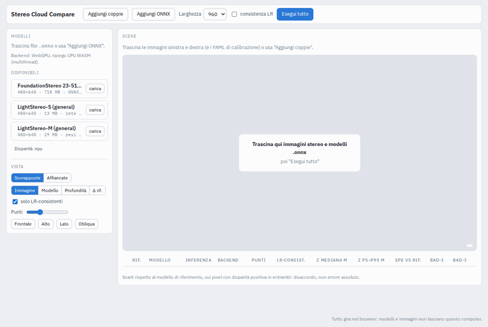

# Stereo Cloud Compare

Compare stereo models in the browser. Stereo pairs in, ONNX models in, point clouds
and disagreement metrics out. Runs on ONNX Runtime Web, no server.



```bash
git clone git@github.com:alessioarcara/stereo-cloud-compare.git && cd stereo-cloud-compare
python3 scripts/setup.py   # ONNX Runtime Web + FoundationStereo (--no-models to skip)
python3 serve.py           # http://localhost:8000
```

Drop left/right images (and `*_stereo_calibration.yaml`), drop `.onnx` models, run.

Pick a reference model in the table. Other models are compared to it on the disparity
map: **EPE** is the mean error in pixels, **Bad-1** / **Bad-3** the share of pixels off
by more than 1 / 3 px.

Models take `left`, `right` 1×3×H×W (RGB 0–255) and return disparity 1×1×H×W; the
input size is read from the file. FoundationStereo (NVIDIA, non-commercial) is the
only model in the catalogue; it is fetched by `setup.py`, not stored here.

WebGPU needs `localhost` or `python3 serve.py --https`; otherwise CPU WASM.
